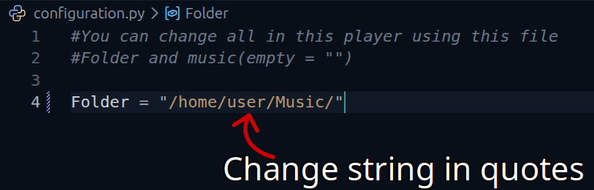

# Sunset player

## Important note
> This project is still under development. If you encounter any errors or bugs, please open an issue on this repository.

## Description
This is a TUI Sunset player by **Solvital**.
Using libraries(Built-in):
- **os**(for exit)
- **pathlib**(for finding path and using it)
- **curses**(For checking key presses & for terminal rendering)
- **time**(To use sleep method)

Using libraries(Dependencies):
- **python-vlc**(for audio)
- **tinytag**(for audio tags)

## Control playback:
1. **Play/Pause** - Play and Pause your favourite tracks by using `x` key!
2. **Next/Previous** - Change your track if you want by using `z` for previous track and `c` for next track
3. **Shuffle** - if your playlist seems boring, shuffle it by using `s` key!
4. **Exit** - if you want to leave, press `q` key!

## Installation
1. Download Python(Python 3.8+ (uses standard libraries: curses, pathlib))
2. Download vlc player(It's important)
3. Download libraries 
```bash
pip install python-vlc tinytag
```
4. Navigate to the project folder
5. Open configuration.py and update the Folder variable with your music directory path.

*Make sure to keep the trailing slash / at the end of the path!*



6. Run main.py file
```bash
python main.py
```
7. Enjoy!

### Windows Support (Experimental)
The project is developed on Linux. For Windows, you need to install `windows-curses`:
```bash
pip install windows-curses
```
*Note: Some colors or keybindings (especially Cyrillic layout) might behave differently.*

## Images
![Sunset player. Now playing: 70. The place where it rained (DELTARUNE Chapter 3+4 Soundtrack) - Toby Fox.mp3 Author: author that you may know
From folder: /home/Solvital/Music/Favourites
Shuffle: [False], Always Repeat
[x] - Pause | [z] - Prev | [c] - Next | [s] - Shuffle | [r] - Repeat | [q] - Quit](Images/Screenshot-first.png)

![Sunset player. Now playing: OneShot OST - On Little Cat Feet (ground) Author: James Wiseman
From folder: /home/Solvital/Music/Favourites
Shuffle: [True], Always Repeat
[x] - Pause | [z] - Prev | [c] - Next | [s] - Shuffle | [r] - Repeat | [q] - Quit](Images/Screenshot-second.png)

